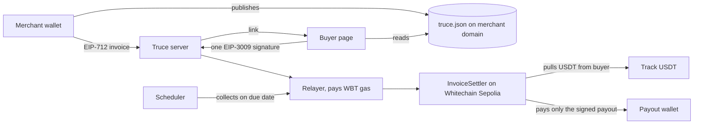

# Truce

Invoices a buyer can verify before paying. A merchant publishes the wallets they bill from on their own domain and signs each invoice; the buyer's page checks the invoice against that file and shows **PASS or FAIL** before a cent moves. The buyer then signs **one** USDT authorization, to pay now or on the due date, and a relayer pays the gas. Our contract, `InvoiceSettler`, pays **only the payout wallet the merchant signed**, so a swapped payee fails twice: in the app and on chain.

Built at ETHGlobal Mumbai 2026 for the Whitechain **Operate** track. Testnet only (Whitechain Sepolia, chain 1874). All example data is fictional and labelled **EXAMPLE DATA**: "Northlight Design Studio" bills "Beta Labs", with the due date time-compressed in the demo.

**Status:** the contract is deployed and verified on Whitechain Sepolia, and the real track USDT has been used for a settlement, a swapped-payout rejection, a pay-on-due-date collection, a buyer cancel and capped refunds (explorer links below). The app runs against a mock chain with no keys, or against the live testnet through the API. The interactive wallet screens (connect, add chain, sign) are covered by component tests, API tests and chain scripts; the full click-through in a browser with a wallet extension is a manual check ([docs/SUBMISSION-CHECKLIST.md](docs/SUBMISSION-CHECKLIST.md)). No mainnet transaction was made and the contract is not audited.

## The problem

A supplier emails "same invoice, but our bank details changed", the buyer pays, and the money goes to someone else. Business email compromise was reported at about $3.05B to the FBI in 2025 (secondary source, [docs/MARKET-RESEARCH.md](docs/MARKET-RESEARCH.md)). In crypto the same mistake is a copied wrong address: address poisoning was over 10% of wallet drains in 2025. Euro bank rails answered with Verification of Payee, which compares a name with an IBAN; USDT has no equivalent.

Two gaps stay open even for buyers who are careful:

- **The check lives on the page.** A payee check that only runs in an app helps nothing if the buyer is rushed, the page is spoofed or the server is wrong. Something has to refuse the wrong payee at the moment money moves, whoever submits the transaction.
- **Pay-later is a promise, not a mechanism.** "Net 30" usually means a reminder and a manual transfer. A buyer who signs once, with a visible risk state before the due date, gives the merchant something better than a reminder without locking the buyer's funds.

## How it works

```
payout fixed by    merchant EIP-712 signature over the invoice (the contract recomputes the digest)
payee check        domain file lists signing wallet + payout wallets; buyer app runs 10 checks -> PASS | FAIL
buyer commitment   one EIP-3009 receiveWithAuthorization (nonce = invoice hash), now or valid from the due date
settlement         contract: verify merchant signature -> pull USDT -> pay inv.payout -> record once
refund             payout wallet signs; contract pays only the recorded payer, capped at what was paid
```

**Signed domain file.** The merchant publishes `/.well-known/truce.json` on their own website: the signing wallet, the payout wallets and the chain. It is the trust anchor, so no platform sits between the buyer and the merchant's own site. The Setup page generates the file, and a **Check my domain** button reads it live (same SSRF-guarded fetch as the buyer's check) and says in plain words whether it lists the wallets about to be used.

**Ten checks, in plain language.** `document_valid`, `signature_valid`, `domain_file_reachable`, `merchant_matches_domain_file`, `payout_in_domain_file`, `domain_hash_matches`, `chain_and_token_allowed`, `not_expired`, `memo_hash_matches_details`, `payer_ok`. Any failure disables Pay and says why. A swapped payout wallet fails two of them. The merchant sees the same verdict right after creating an invoice ("Your buyer will see PASS" or "FAIL, so do not send this link yet", with what to change).

**One hash, three jobs.** The invoice hash is the EIP-712 digest, the EIP-3009 nonce and the on-chain settlement key. The buyer's single signature is therefore bound to exactly one invoice, and each invoice settles once. TypeScript and Solidity hashes are checked against shared golden vectors.

**On-chain payee enforcement.** `settle` reverts unless the merchant's signature (EOA or ERC-1271) covers the exact payout wallet being paid. The track USDT's `receiveWithAuthorization` requires `msg.sender == to`, so our contract is the recipient and forwards to `inv.payout`. The relayer can submit or delay a payment; it cannot redirect it.

**Pay on the due date.** The buyer signs once, valid from the due date to the end of the payment window. A scheduler collects it after the due time. Before that, a health snapshot (balance, blocked, cancelled) marks the invoice **At risk** so the merchant can act early. On low balance it retries with backoff (30 s doubling to 10 min) until the window closes, then shows **Failed** with the reason, takes nothing and stops. The buyer can cancel on chain with a signed `cancelAuthorization`. The authorization is a commitment, not locked funds, and the health check is a snapshot, not a lock.

**Capped refunds.** The payout wallet signs a refund authorization (nonce derived from the invoice hash and the amount already refunded). The contract returns the money to the recorded payer only, never above what was paid, and works while paused.

**The attack we show.** Someone swaps the payout wallet in an invoice (an email, a link, a compromised page). The app shows **FAIL** and disables Pay. If the same buyer authorization is sent to the contract with the swapped wallet anyway, the contract reverts with `BadMerchantSignature`. The second line of defence does not depend on the app, the server or the relayer behaving. `npm run e2e -- --attack-only` shows it and sends nothing.

**Key pinning.** The buyer's browser remembers which wallets a domain used at the last payment and warns if they change. For a domain this browser has not seen before it says so and suggests confirming the payout wallet another way for large amounts.

## Architecture



```
contracts/            InvoiceSettler (Solidity 0.8.30, evm prague, OpenZeppelin v5) + Foundry tests
packages/invoice-lib/ EIP-712 invoice, hashes, signing, ten-check verify pipeline, EIP-3009 builders (TypeScript)
apps/server/          Fastify API, JSON-file store, SSRF-guarded domain-file fetch, chain module (viem or mock), due-date scheduler
apps/web/             React app: merchant, buyer, public verify
sdk/, examples/       merchant SDK, the 10-line example app, the storefront demo
scripts/              end-to-end scripts that run against the live testnet
docs/                 spec, design, decisions log, audit
```

The relayer simulates a settlement, refund or cancel before sending and only sends if the simulation passes. It has a daily WBT budget and a per-IP rate limit, and the chain module refuses to send on any chain other than 1874. Reads fall back to a backup RPC; sends never do.

## Whitechain integration

| Piece | How Truce uses it |
|---|---|
| Track USDT `0xcedfB561…55a7` | EIP-3009 `receiveWithAuthorization`, `cancelAuthorization` and `isBlocked`, on an EIP-1967 proxy. EIP-712 domain "Tether USD", version 1, chain 1874 (reconstructed locally and matched against the on-chain `DOMAIN_SEPARATOR`). |
| Gasless buyer | A relayer pays the fee in WBT; the buyer holds no WBT. The receipt shows the network fee and who paid it, read from the explorer's API for that transaction. |
| Chain 1874 and Blockscout | Deployment, verification and every evidence link. Public RPC plus the documented backup RPC for reads. |
| Operate track asks | A drop-in piece a separate app adds in about 20 lines (the SDK; 9 to 10 lines in the examples), merchant and customer views, refunds, renewals (a monthly series of separate invoices) and an accountant export (CSV and ledger). |

Findings from building on it are in [WHITECHAIN_FEEDBACK.md](WHITECHAIN_FEEDBACK.md).

### Why a stablecoin on chain, and not a bank transfer

For a buyer and a merchant who already hold USDT (crypto-native companies, DAOs and the agencies that bill them), a bank transfer means converting out and back, waiting for banking hours, and trusting a payee check that only the banks see. Settling in the USDT they hold takes one signature and no gas for the buyer, and both sides can check the payment against a public record. The payee rule is enforced by code when the money moves, not by a process around it. A due-date collection is a signed authorization the buyer can cancel on chain, and anyone can read `payments(hash)` to confirm a payment without trusting our server.

Limits: this fits only parties who already hold stablecoins, we have no adoption data, and Truce does not replace bank rails. For buyers without stablecoins a bank transfer is the better choice.

## Where to look

Line numbers are as of the commit that wrote this README.

| What | File:lines |
|---|---|
| Settle: expiry, token, payer lock, once-only, merchant signature, pull, pay payout | [contracts/src/InvoiceSettler.sol:93-128](contracts/src/InvoiceSettler.sol) |
| Capped refund to the recorded payer; refund nonce | `InvoiceSettler.sol:130-154` |
| Invoice digest; read a payment; pause (new settlements only) | `InvoiceSettler.sol:86`, `160`, `169-175` |
| Contract tests: settle, swapped payout, expiry, double settle, ERC-1271, refunds, invariants, golden vectors | [contracts/test/](contracts/test/) |
| The ten checks | [packages/invoice-lib/src/verify.ts:8-19, 64](packages/invoice-lib/src/verify.ts) |
| EIP-712 invoice hash, domain hash | `packages/invoice-lib/src/hash.ts:21-41` |
| Relayer: simulate first (131), daily budget (138), health snapshot (207), cancel (235) | [apps/server/src/chain/viem.ts](apps/server/src/chain/viem.ts) |
| Scheduler: tick, collect now, retry with backoff, fail, health refresh | [apps/server/src/scheduler.ts:61-201](apps/server/src/scheduler.ts) |
| SSRF-guarded domain-file fetch (https only, no redirects, 3 s, 64 KB, pinned address) | [apps/server/src/domain/fetchDomainFile.ts:30](apps/server/src/domain/fetchDomainFile.ts), `ssrfGuard.ts:50-65` |
| Domain resolver (cached) and the fresh "Check my domain" read | `apps/server/src/domain/resolver.ts:83-102`, [api/domainCheck.ts:29](apps/server/src/api/domainCheck.ts) |
| Demo-only registration of fictional `.example` names | `resolver.ts:55`, route `routes.ts:138` |
| API routes (create, verify, authorize, cancel, refund, collect, CSV, ledger) | [apps/server/src/api/routes.ts](apps/server/src/api/routes.ts) |
| CSV (with `refunded`, `net_received`) and ledger export | `apps/server/src/api/csv.ts:49`, [api/ledger.ts:59-98](apps/server/src/api/ledger.ts) |
| Buyer pay gate, payee-changed pins, merchant fix hints, refund and series maths | `apps/web/src/lib/payGate.ts:27`, `pins.ts:70`, `merchantHints.ts:8`, `refund.ts`, `series.ts` |
| Merchant SDK | [sdk/README.md](sdk/README.md), [examples/merchant-demo/shop.ts](examples/merchant-demo/shop.ts) |
| Live scripts | [scripts/](scripts/) (`e2e-settle`, `e2e-api`, `e2e-due`, `e2e-refund`) |

## Evidence on Whitechain Sepolia (chain 1874, testnet)

- `InvoiceSettler` with capped refunds (verified): [0xCbe41B98D2333a1BD92d51Fbb6FE668c5170ff9d](https://explorer.testnet.whitechain.io/address/0xCbe41B98D2333a1BD92d51Fbb6FE668c5170ff9d). Record: [deployments/whitechain-sepolia.json](deployments/whitechain-sepolia.json). The first deployment ([0xB1e1...fE7](https://explorer.testnet.whitechain.io/address/0xB1e1c081D5FB009D8f908b220D902E9F98dfbFE7), settle only) stays on chain and is listed as `previous` in that record.

| What | Transaction | Reproduce |
|---|---|---|
| Settlement in the track USDT (0.01 USDT, example invoice, relayer pays gas): the buyer's USDT went to the contract and straight out to the payout wallet the merchant signed | [0xd34ac0c2…efed](https://explorer.testnet.whitechain.io/tx/0xd34ac0c27f31e7c5c87d25a6fc6e9e6f403400cb309a65489c851ef0a526efed) | `npm run e2e` |
| Swapped payout wallet with the same buyer authorization is rejected by the contract | nothing sent | `npm run e2e -- --attack-only` |
| The same payment through the HTTP API (create, verify, swapped-payout copy refused, one buyer signature, status, CSV) | [0x99291356…516b9](https://explorer.testnet.whitechain.io/tx/0x992913567d1337f578208ae0364166d5e41cba416bc821cf68dec3bc126516b9) | `npm run e2e:api` |
| Pay on the due date, collected by the scheduler (due about 70 s away: time-compressed) | [0xe4f4df28…6882](https://explorer.testnet.whitechain.io/tx/0xe4f4df28c0df800c7ee89df1ea671c6129e6165773a93ba521deaeb69a0e6882) | `npm run e2e:due` |
| Buyer cancel, signed by the buyer and relayed | [0xe8fce82e…3c2a](https://explorer.testnet.whitechain.io/tx/0xe8fce82e8453c9c1f6d6b1d5177294ac9996ba3b1c34c63fa4e822af1b873c2a) | `npm run e2e:due` |
| Capped refund: payment, then 0.005 USDT back to the original payer, signed by the payout wallet (a refund above the remaining amount is rejected by the contract) | [payment 0xf2945011…148a](https://explorer.testnet.whitechain.io/tx/0xf294501133d5996591cf326f04601ca049f625ef94fefe29a0fd3c875f6c148a), [refund 0x9e15507d…2e79](https://explorer.testnet.whitechain.io/tx/0x9e15507d2c58df4f3fbd668e6be096cc7589d00ecac306e037b5660d22ee2e79) | `npm run e2e:refund` |
| Refund through the API and dashboard route: 0.002 USDT of 0.01 returned to the buyer (payout wallet to contract to buyer); above what is left is refused with `REFUND_EXCEEDS_PAID` | [payment 0x9b378a38…e281](https://explorer.testnet.whitechain.io/tx/0x9b378a38ee8a37ef5231f765575297db205c18b40f0b55a446a51a984d8ce281), [refund 0x816e2a2b…4605](https://explorer.testnet.whitechain.io/tx/0x816e2a2bbce17c723c46d340a92dc1a2142c41bd0a7314775847c92fc6d34605) | `npm run e2e:api` |

**Tests.** Foundry 49 (settle, swapped payout, tampered amount, wrong signer, expiry, double settle, payer lock, fee-on-transfer token, ERC-1271 merchant, pause, golden vectors shared with TypeScript, fuzz and invariants, capped refunds). Library 74. Server 205 (fake-clock scheduler suite, SSRF, refund route, ledger, RPC fallback, domain check, demo-domain registry). Web 106, plus 11 opt-in smoke tests that run the web client against a live server (`npm run smoke:web`). SDK 4. Demo storefront 8. A fresh clone of an earlier commit passed the whole suite ([docs/AUDIT.md](docs/AUDIT.md) section 10e); counts have grown since.

## What is in the app

| Page | What it does |
|---|---|
| `/setup` | Connect the signing wallet, name the domain and payout wallet, download or copy `truce.json`, then **Check my domain**. On a demo server, a fictional `.example` name can be registered with one click. |
| `/merchant` | Create and sign invoices, see status (awaiting, scheduled, at risk, paid, failed, cancelled), download two accountant files: a CSV with one row per invoice (including `refunded` and `net_received`) and a **ledger** with one row per money movement (issued, payment, refund), each payment and refund with its explorer link. The list refreshes every few seconds and flashes a row when its status changes. Open an invoice to **refund** it in full or in part. An optional field makes a series of separate monthly invoices (not a subscription). For example data, a demo field makes an invoice due in a few minutes. |
| `/pay/<hash>` | The buyer page: ten plain-language checks and a big PASS or FAIL, the full payout wallet, a payee-changed warning, pay now or on the due date, cancel a scheduled payment, and a receipt with the network fee. |
| `/` | Landing page: the live PASS/FAIL demo, a tamper lab, and a "Reported in the real world" section with three sourced reports (FBI IC3 2025, AFP 2025 survey summary, a $50M USDT address-poisoning incident) that link to the originals. The figures are the publishers' and are labelled as such. |
| `/verify` | Public check, no wallet: paste a link, a hash or the invoice JSON. Shows PASS or FAIL and whether it was paid on chain. A bare `0x…` must be the invoice hash; the "Invoice id" shown in an invoice panel is a different value. |

In demo (mock) mode every page shows a red **DEMO MODE** banner: no server and no chain, payments are simulated and make no transaction. Real testnet transactions need server mode.

**Drop-in SDK** ([sdk/README.md](sdk/README.md)): `createInvoice({ apiBase, signer, domain, merchantName, clientName, lineItems })` returns `{ link, hash }`. The example app [examples/merchant-demo/invoice.ts](examples/merchant-demo/invoice.ts) needs **10 lines** of integration code (counted by `npm run count:sdk-lines`; our limit is 20). A visible version is the fictional studio's website, [examples/merchant-demo/shop.ts](examples/merchant-demo/shop.ts): an "Invoice me" button calls its server, which creates a signed Truce invoice in **9 lines** and returns the pay link (`npm run shop -w @truce/merchant-demo`, then open http://127.0.0.1:8800).

### Read it like an accounts-receivable module

The parts line up with the usual ERP-style layers: master data (merchant setup, `truce.json`, the token allowlist), documents (the signed invoice, the buyer's payment authorization, the refund), processes (verification, settlement, collections, cancellation, refund), records (the event history and the on-chain payment record) and reports (dashboard, CSV, public verify page). The on-chain record plays the part of the bank statement in a three-way match with the signed invoice and the buyer's authorization. This is a way to read the structure, **not an ERP and not an ERP integration**: there are no users, roles or approvals. Mapping with file locations: [docs/design/G-ERP-STYLE-VIEW.md](docs/design/G-ERP-STYLE-VIEW.md).

## Run it

Needs Node 22+, npm, and (for the contract) [Foundry](https://getfoundry.sh). On Windows use Git Bash for Foundry.

```bash
git clone --recurse-submodules https://github.com/isithore002/Truce.git && cd Truce
npm install
npm run test:all                      # lib, server, web, sdk, storefront and Foundry tests

# Demo with no keys and no network: a mock chain and the fictional example merchant
DEMO_DOMAINS=1 npm run server         # terminal 1: API on http://127.0.0.1:8787 (mock chain)
npm run dev -w apps/web               # terminal 2: web app on http://localhost:5173 (default: scripted mock mode, no server)
```

**Server mode (what to record and what produces real transactions).** Put this in `apps/web/.env.local`, restart Vite, and open the app as `localhost:5173` (not `127.0.0.1`; the server's CORS allows exactly that origin). There must be no red DEMO MODE banner.

```
VITE_API_MODE=server
VITE_API_BASE=http://localhost:8787
VITE_EXAMPLE_MODE=1
```

**Against the real testnet.** Copy `.env.example` to `.env`, fill in **throwaway** testnet keys (never a key that held real funds), fund the buyer with test USDT (swap WBT on YetiTrade) and the relayer with WBT (faucet), then:

```bash
CHAIN_MODE=testnet DEMO_DOMAINS=1 npm run server
npm run e2e -- --attack-only          # swapped payout rejected by the contract, sends nothing
npm run e2e                           # one real 0.01 USDT settlement
npm run e2e:api                       # the same through the HTTP API
npm run e2e:due                       # pay-on-due-date collected by the scheduler, plus a buyer cancel
npm run e2e:refund                    # settle, then a capped refund to the original payer
```

Use small amounts (0.01 USDT): the test wallets hold a few USDT, and a 1,250 USDT invoice cannot be paid. Keys are read from `.env` and never printed.

**Server settings** (all optional; see `.env.example`): `RELAYER_DAILY_BUDGET_WBT` (default 0.5), `RATE_LIMIT_PER_MINUTE`, `CONFIRM_TIMEOUT_MS`, `RPC_URL`, `RPC_FALLBACK_URL` (`none` turns the backup off), `DEMO_DOMAINS=1` (serve fictional `.example` merchants), `DEMO_REGISTRY_DIR` (where demo names registered on Setup are kept; git-ignored).

**Real domain.** The merchant publishes `https://<domain>/.well-known/truce.json` (no redirects, valid JSON) and presses **Check my domain**. Truce does not publish it for them: the domain is the trust anchor.

## Overlap with other entries

Other entries on the same testnet also do merchant-signed invoices, EIP-3009 pulls and refunds (for example `PaymentRouter`, `PaymentProcessor`, `Checkout`). At least one (`MerchantRegistry` `0xF6B6...6C47`) records domain verification through a platform attestor after an off-chain DNS or .well-known check. Truce's difference is where that trust sits: the buyer's own check reads the merchant's published file directly with no platform in between, and the contract enforces the signed payout wallet at settlement. We read other teams' contracts only to assess overlap; ours was written from scratch. Competitor scan run on 2026-11-06 with `npm run radar`.

Prior art we build on, credited: BIP-353 and Lightning Address (domain-bound payment details, `.well-known`), EIP-3009 and EIP-712, OpenZeppelin v5 (`EIP712`, `SignatureChecker`, `Ownable`, `Pausable`, `ReentrancyGuard`), EU Verification of Payee (the fiat idea of checking a payee before paying). Competitors and what differs: [docs/COMPETITORS.md](docs/COMPETITORS.md).

## Security, limitations and trust

**Review status.** An internal review and the autonomous-run audit are in [docs/AUDIT.md](docs/AUDIT.md). The contract has not had an external audit. When the audit was written, scans of the repo for secrets and over-claims were clean and no `.env` or key file was tracked.

**Trust assumptions.**

- The merchant's domain file is the trust anchor. If the site is compromised, the file can list another wallet.
- The relayer can delay or censor a payment, but not redirect it: the buyer signature fixes token, amount, destination (the contract) and nonce, and the contract pays the payout wallet the merchant signed. The buyer can also submit the transaction themselves.
- The contract owner can only pause new settlements. No function lets anyone else move funds, and refunds still work while paused.
- The track USDT is an upgradeable proxy with a blocklist function, so its behaviour is up to its issuer.

**Limitations (please read).**

- **A signed authorization is a commitment, not locked funds.** On the due date the buyer's balance may be too low; then the collection fails and the invoice shows Failed. There is no escrow or collateral and no on-chain way to compel payment. The merchant keeps the signed invoice and the buyer's authorization as evidence, and a failed invoice is followed by a new invoice or an off-chain claim. The balance and health check is a **snapshot, not a lock**.
- **Testnet only, example data only, no real users.** No mainnet transaction was made.
- **Invoices are not private.** Truce checks who you are paying; it does not hide the invoice. Merchant, payer, payout and amount are public on chain. The invoice text (client name, line items, notes) is stored unencrypted on our server, and only its hash is on chain. Anyone with an invoice link, or access to the server, can read it. A leaked link exposes the details, not the funds: the payout is fixed by the merchant's signature. Reading restricted to a wallet, and stealth recipient addresses, are not built (stealth is a later phase in [docs/SPEC.md](docs/SPEC.md)).
- **The domain file is the trust anchor, and its limits are ours.** A lookalike domain, or a domain taken over before the first payment, is not detected. Key pinning helps only afterwards, and pins live in one browser's localStorage (a new browser starts with none). DNSSEC is not checked.
- **The domain check has a 3-second deadline.** A slow host can read as "the request timed out" for the merchant and for buyers (GitHub Pages took about 2.2 s from our machine). Redirects, for example from `www`, are not followed.
- **Demo-name registration has no ownership proof.** It exists only in demo mode, only for fictional `.example` names, never replaces a built-in example and never lets a second wallet take a registered name. It is not a way to register a real domain.
- **Off-chain signature checks support EOA merchant wallets.** The contract also accepts ERC-1271 contract wallets, but the app's PASS/FAIL cannot verify those. Buyers sign with `v, r, s`, so contract-wallet buyers are not supported.
- **No merchant login.** Anyone who knows a merchant's signing address (it is public in `truce.json`) can list that merchant's invoices and download the CSV. Invoice links are unguessable hashes, but the merchant list is not private in this build.
- **RPC reads fall back to a backup node; sending does not.** Simulation, receipts and balance reads try the primary RPC and then the documented backup. A transaction is only ever sent through the primary, so a send that timed out is not offered to a second node. If the primary is down, payments wait or fail rather than being sent elsewhere.
- **One relayer, one server.** A single relayer key with a daily WBT budget and a per-IP rate limit; invoices are kept in a JSON file; the due-date scheduler runs inside the server process. If the server is down at the due time it catches up on restart, until the authorization expires.
- **Refunds need the payout wallet to sign and to hold the USDT.** It must be an ordinary wallet (the refund is an EIP-3009 authorization), and the amount comes out of that wallet at refund time. A refund can only go to the wallet that paid, and never above the amount paid. The dashboard list does not show a "refunded" badge yet; the refund panel in the invoice drawer reads the amount from the chain.
- **The ledger and the CSV are exports, not accounting software.** The ledger has four illustrative accounts (accounts receivable, sales revenue, cash in USDT, sales returns) and no tax, write-offs or period closing. Refunds in both files come from the refunds this server recorded; a refund sent some other way (a script straight to the contract) is not in them, and the chain remains the source of truth. A cancelled authorization, a failed collection or an expiry moves no money, so it has no ledger row; it stays in the invoice's history. A rejected swapped-payout copy is never stored, so it appears in neither file.
- **A monthly series is only a faster way to create invoices.** Each one is signed, paid and (optionally) scheduled on its own. Nothing recurs by itself, and nothing is charged without the buyer's own signature for that invoice.
- **The Soul badge is mocked.** It shows "Individual KYC-verified on WhiteBIT (demo data, mocked)" for the example merchant, in example mode only. WB Soul's verified flag reflects one individual's personal KYC and says nothing about a business. No real Soul data is read.
- Not built: stealth addresses, webhooks, approvals, ERP integrations (CSV export only), DNSSEC, mainnet.

## Team

Built for this hackathon by [isithore002](https://github.com/isithore002), with web front-end contributions from nithishjude (see the git history). AI assistance (Claude Code) is documented in [docs/AI-USE.md](docs/AI-USE.md), including what was reviewed by hand.

More docs: scope and decisions ([docs/SPEC.md](docs/SPEC.md), [docs/DECISIONS-LOG.md](docs/DECISIONS-LOG.md)), design and API ([docs/design/00-INDEX.md](docs/design/00-INDEX.md), [docs/INTERFACES.md](docs/INTERFACES.md)), evidence and adoption plan ([docs/MARKET-RESEARCH.md](docs/MARKET-RESEARCH.md)), pitch and judge Q&A ([docs/PITCH.md](docs/PITCH.md)), demo script ([docs/VIDEO-SCRIPT.md](docs/VIDEO-SCRIPT.md)), submission checklist ([docs/SUBMISSION-CHECKLIST.md](docs/SUBMISSION-CHECKLIST.md)), Whitechain feedback ([WHITECHAIN_FEEDBACK.md](WHITECHAIN_FEEDBACK.md)), audit of this build ([docs/AUDIT.md](docs/AUDIT.md)).
