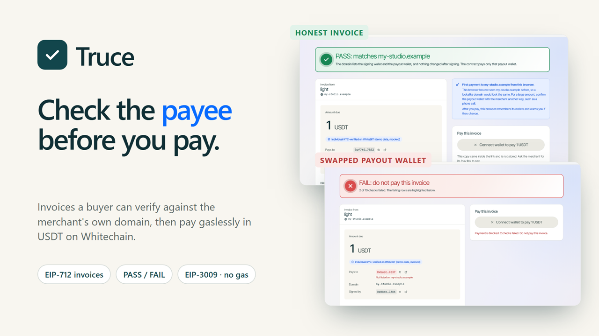
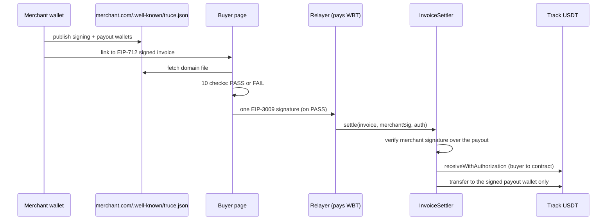
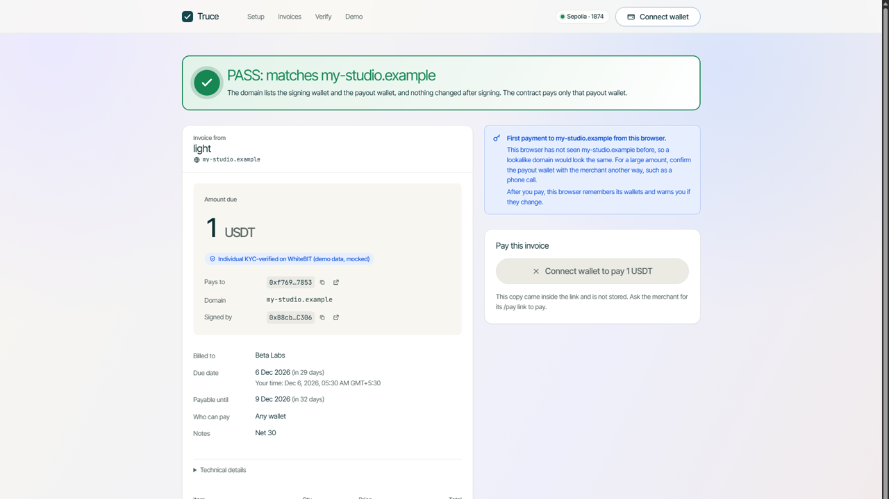
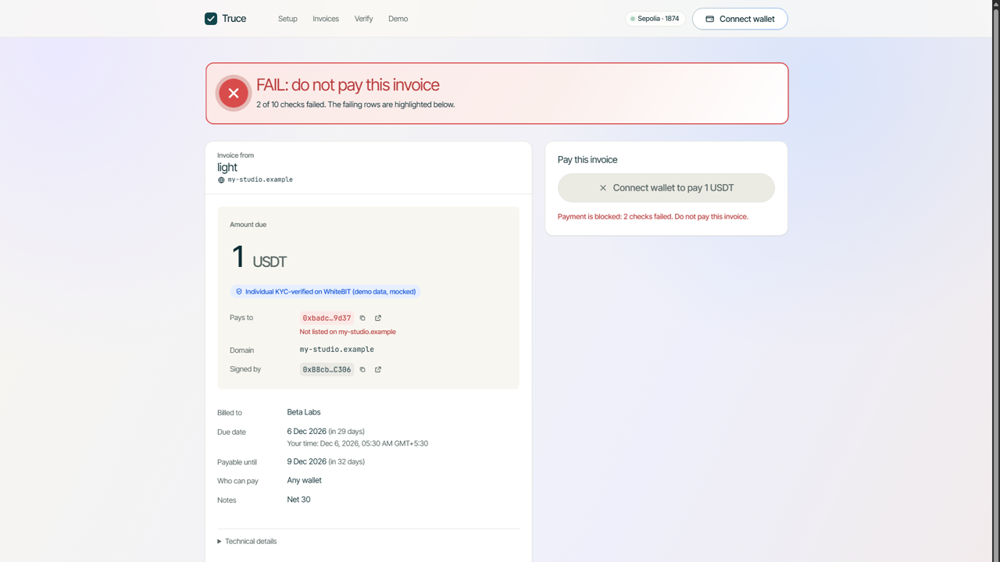
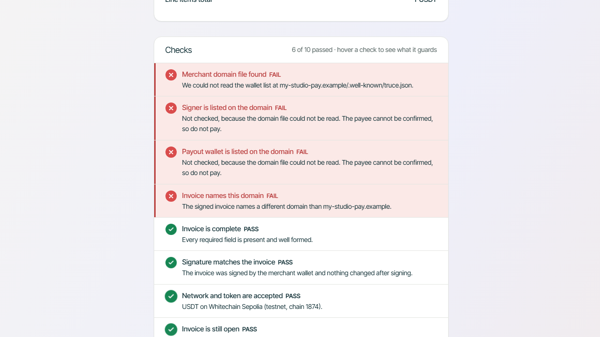
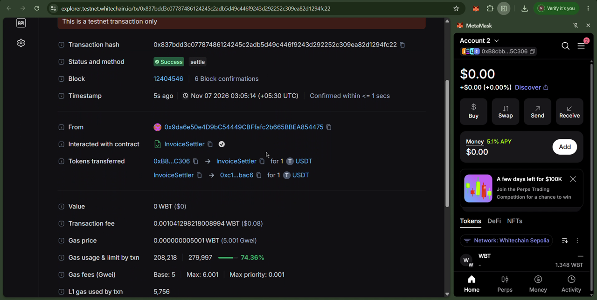
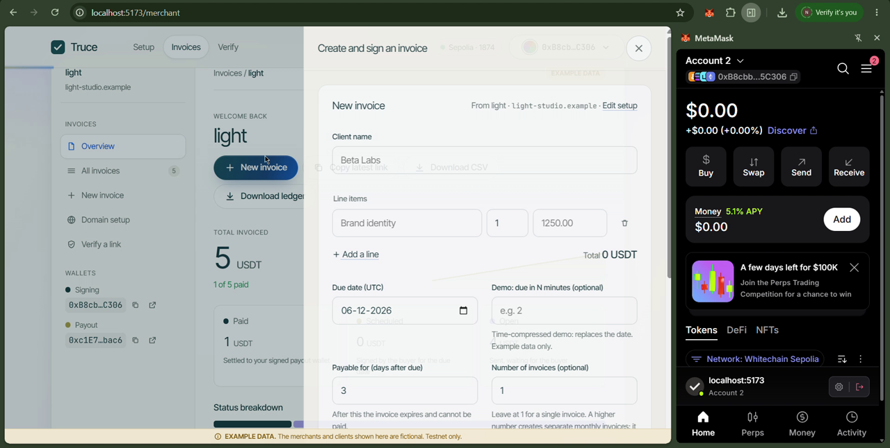
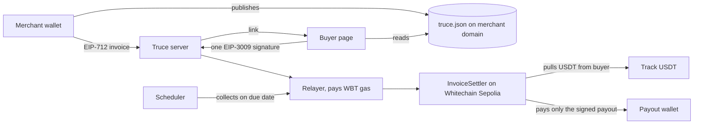

# Truce

**Invoices a buyer can verify before paying, then pay gaslessly in USDT on Whitechain.**

A merchant publishes the wallets it bills from on its own domain and signs every invoice. Before a cent moves, the buyer's page checks the invoice against that file and shows **PASS or FAIL**. The buyer then signs **one** USDT authorization (pay now, or on the due date) and a relayer pays the gas. Our contract, `InvoiceSettler`, pays **only the payout wallet the merchant signed**, so a swapped payee fails twice: in the app and on chain.



| | |
|---|---|
| **Event** | ETHGlobal Mumbai 2026, Whitechain **Operate** track |
| **Network** | Whitechain Sepolia testnet, chain id `1874` (testnet only, no mainnet transactions) |
| **Contract** | `InvoiceSettler` [`0xCbe41B98D2333a1BD92d51Fbb6FE668c5170ff9d`](https://explorer.testnet.whitechain.io/address/0xCbe41B98D2333a1BD92d51Fbb6FE668c5170ff9d) (verified) |
| **Token** | Track USDT [`0xcedfB56113143d55b2358b8CFbB0dEB5Ad2f55a7`](https://explorer.testnet.whitechain.io/address/0xcedfB56113143d55b2358b8CFbB0dEB5Ad2f55a7) (EIP-3009) |
| **Demo site** | https://truce-web.vercel.app (demo mode: no server, no chain, payments simulated) |
| **Standards** | EIP-712 (signed invoices), EIP-3009 (gasless USDT), ERC-1271 (contract-wallet merchants), EIP-6963 (wallet discovery) |
| **Example data** | Fictional and labelled **EXAMPLE DATA**: "Northlight Design Studio" bills "Beta Labs" 1,250 USDT, net 30 (time-compressed in the demo) |

## Contents

1. [The problem](#1-the-problem)
2. [How it works](#2-how-it-works)
3. [The attack Truce stops](#3-the-attack-truce-stops)
4. [Screenshots](#4-screenshots)
5. [Architecture](#5-architecture)
6. [The smart contract](#6-the-smart-contract)
7. [Whitechain integration](#7-whitechain-integration)
8. [What is in the app](#8-what-is-in-the-app)
9. [Getting started](#9-getting-started)
10. [Evidence on chain](#10-evidence-on-chain)
11. [Tests](#11-tests)
12. [Where to look in the code](#12-where-to-look-in-the-code)
13. [Security, trust and limitations](#13-security-trust-and-limitations)
14. [Overlap and prior art](#14-overlap-and-prior-art)
15. [Documentation, team and AI use](#15-documentation-team-and-ai-use)

**Status.** The contract is deployed and verified on Whitechain Sepolia. The real track USDT has been used for settlements, a swapped-payout rejection, a pay-on-due-date collection, a buyer cancel and capped refunds (links in [section 10](#10-evidence-on-chain)). The full flow has been clicked through in a browser with MetaMask, including a 1 USDT payment. The app also runs against a mock chain with no keys. The contract is not externally audited.

---

## 1. The problem

A supplier emails "same invoice, but our bank details changed". The buyer pays, and the money goes to someone else. Business email compromise was reported at about $3.05B to the FBI in 2025 (secondary source, [docs/MARKET-RESEARCH.md](docs/MARKET-RESEARCH.md)). In crypto the same mistake is a copied wrong address: address poisoning was over 10% of wallet drains in 2025. Euro bank rails answered with Verification of Payee, which compares a name with an IBAN; USDT has no equivalent.

Two gaps stay open even for careful buyers:

- **The check lives on the page.** A payee check that only runs in an app does nothing if the buyer is rushed, the page is spoofed or the server is wrong. Something has to refuse the wrong payee at the moment money moves, whoever submits the transaction.
- **Pay-later is a promise, not a mechanism.** "Net 30" usually means a reminder and a manual transfer. A buyer who signs once, with a visible risk state before the due date, gives the merchant something better than a reminder without locking the buyer's funds.

## 2. How it works

### The flow in five steps

1. **Publish.** The merchant puts `/.well-known/truce.json` on its own website: its signing wallet, its payout wallets and the chain. The Setup page generates the file and **Check my domain** reads it back live.
2. **Sign.** The merchant creates an invoice and signs it (EIP-712) over the amount, token, payout wallet, due date, expiry and domain. Nothing goes on chain and no gas is spent; the merchant sends a link.
3. **Verify.** The buyer opens the link. The page fetches the merchant's domain file and runs **ten checks**. Any failure shows **FAIL**, disables Pay and says why.
4. **Authorize.** On **PASS** the buyer signs one EIP-3009 `receiveWithAuthorization`, valid now or from the due date. No approval and no gas: the buyer needs only USDT.
5. **Settle.** A relayer submits it and pays the WBT fee. `InvoiceSettler` verifies the merchant's signature again, pulls the USDT and pays **only the signed payout wallet, once**.



### Summary

```
payout fixed by    merchant EIP-712 signature over the invoice (the contract recomputes the digest)
payee check        domain file lists signing wallet + payout wallets; buyer app runs 10 checks -> PASS | FAIL
buyer commitment   one EIP-3009 receiveWithAuthorization (nonce = invoice hash), now or valid from the due date
settlement         contract: verify merchant signature -> pull USDT -> pay inv.payout -> record once
refund             payout wallet signs; contract pays only the recorded payer, capped at what was paid
```

### The ten checks

Each check has a plain-language label in the app, and hovering a check shows what it guards against.

| # | Check | Fails when |
|---|---|---|
| 1 | `document_valid` | A required field is missing or malformed |
| 2 | `signature_valid` | Anything changed after the merchant signed (amount, payout, domain, dates) |
| 3 | `domain_file_reachable` | `truce.json` cannot be read from the merchant's domain |
| 4 | `merchant_matches_domain_file` | The signing wallet is not the one the domain publishes |
| 5 | `payout_in_domain_file` | The payout wallet is not listed on the domain |
| 6 | `domain_hash_matches` | The signed invoice names a different domain |
| 7 | `chain_and_token_allowed` | Wrong chain or token |
| 8 | `not_expired` | The payment window has closed |
| 9 | `memo_hash_matches_details` | Line items, names or notes differ from what was signed |
| 10 | `payer_ok` | The invoice is restricted to another payer wallet |

The merchant sees the same verdict right after creating an invoice ("Your buyer will see PASS", or "FAIL, so do not send this link yet" with what to change).

### Key mechanisms

- **One hash, three jobs.** The invoice hash is the EIP-712 digest, the EIP-3009 nonce and the on-chain settlement key. The buyer's single signature is bound to exactly one invoice, and each invoice settles once. TypeScript and Solidity hashes are checked against shared golden vectors.
- **On-chain payee enforcement.** `settle` reverts unless the merchant's signature (EOA or ERC-1271) covers the exact payout wallet being paid. The track USDT's `receiveWithAuthorization` requires `msg.sender == to`, so the contract is the recipient and forwards to `inv.payout`. The relayer can submit or delay a payment; it cannot redirect it.
- **Pay on the due date.** The buyer signs once, valid from the due date to the end of the payment window, and a scheduler collects it after the due time. Before that, a health snapshot (balance, blocked, cancelled) marks the invoice **At risk** so the merchant can act early. On low balance it retries with backoff (30 s doubling to 10 min) until the window closes, then shows **Failed** with the reason, takes nothing and stops. The buyer can cancel on chain with a signed `cancelAuthorization`.
- **Capped refunds.** The payout wallet signs a refund authorization (nonce derived from the invoice hash and the amount already refunded). The contract returns money to the recorded payer only, never above what was paid, and refunds work while the contract is paused.
- **Key pinning.** The buyer's browser remembers which wallets a domain used at the last payment and warns if they change ("Was 0xc1E7…, now 0xf769…"), and Pay stays locked until the buyer confirms the change. For a domain it has not seen before it says so and suggests confirming the payout wallet another way for large amounts.

## 3. The attack Truce stops

An attacker copies a real invoice and changes one thing. Each case below was run in the real app with a copy of a signed invoice carried in the link, and the results are what the app showed:

| What the attacker changes | Checks that fail | In the app | On chain |
|---|---|---|---|
| Amount 1 → 10 USDT | Signature (1 of 10) | FAIL, Pay blocked | `BadMerchantSignature` |
| Payout wallet swapped for their own | Signature, payout listed (2 of 10) | FAIL, "Not listed on my-studio.example" | `BadMerchantSignature` |
| Domain swapped for a lookalike | Domain file, signer, payout, domain name (4 of 10) | FAIL, "Not the signer listed on …" | `BadMerchantSignature` |
| Re-signed with the attacker's own key | Signer listed on the domain | FAIL, Pay stays disabled | Not caught: the contract cannot read domains, so the app's domain check is the defence here |

For the first three, the second line of defence does not depend on the app, the server or the relayer behaving. Sending the buyer's real authorization to the contract with a swapped payout reverts, as `npm run e2e -- --attack-only` shows (it sends nothing):

```
ATTACK: swap the payout to 0x76F1…1d9e and settle with the buyer's authorization...
  rejected on chain (simulation): SIGNATURE_INVALID / BadMerchantSignature. Nothing was sent.
```

## 4. Screenshots

| Honest invoice: PASS | Swapped payout wallet: FAIL |
|---|---|
|  |  |
| **Lookalike domain: the failing checks** | **Settled on the Whitechain explorer** |
|  |  |



## 5. Architecture



### Components

| Module | Stack | Responsibility |
|---|---|---|
| [`contracts/`](contracts/) | Solidity 0.8.30, evm prague, OpenZeppelin v5, Foundry | `InvoiceSettler`: signature check, settle once, pay the signed payout, capped refunds, pause |
| [`packages/invoice-lib/`](packages/invoice-lib/) | TypeScript, viem | EIP-712 invoice, hashes, signing, the ten-check verify pipeline, EIP-3009 builders; shared by browser and server |
| [`apps/server/`](apps/server/) | Node, Fastify, viem, Zod | REST API, JSON-file store, SSRF-guarded domain-file fetch, relayer (viem or mock chain), due-date scheduler |
| [`apps/web/`](apps/web/) | React 19, Vite, React Router, viem | Merchant setup and dashboard, buyer pay page, public verify page, EIP-6963 wallet connect |
| [`sdk/`](sdk/) | TypeScript | `createInvoice()` for a merchant's own app |
| [`examples/`](examples/) | TypeScript | The 10-line example app and a storefront demo |
| [`scripts/`](scripts/) | TypeScript (tsx) | End-to-end scripts against the live testnet |
| [`gate/`](gate/) | Node | Gate 1: the track USDT's EIP-3009 surface, read-only and live |
| [`docs/`](docs/) | Markdown | Spec, design, decisions log, audit |

The relayer simulates a settlement, refund or cancel before sending and only sends if the simulation passes. It has a daily WBT budget and a per-IP rate limit, and the chain module refuses to send on any chain other than 1874. Reads fall back to a backup RPC; sends never do.

## 6. The smart contract

[`contracts/src/InvoiceSettler.sol`](contracts/src/InvoiceSettler.sol), EIP-712 domain `("Truce", "1")`, `Ownable`, `Pausable`, `ReentrancyGuard`.

| Function | What it does |
|---|---|
| `settle(Invoice inv, bytes merchantSig, Auth a)` | Checks expiry, token and payer lock; settles each invoice once; verifies the merchant signature (EOA or ERC-1271); pulls the USDT with `receiveWithAuthorization`; pays `inv.payout`; records the payment |
| `refund(bytes32 hash, uint256 amount, Auth m)` | Pulls a refund signed by the payout wallet and pays it to the recorded payer, capped at what was paid |
| `hashInvoice(Invoice inv)` | The EIP-712 digest (also the EIP-3009 nonce and settlement key) |
| `payments(bytes32 hash)` / `paidToken(bytes32 hash)` | Public record of a payment: anyone can confirm it without trusting our server |
| `refundNonce(bytes32 hash)` | The nonce the next refund authorization must use |
| `pause()` / `unpause()` | Owner only; stops new settlements, never refunds |

Errors: `InvoiceExpired`, `AlreadyPaid`, `BadMerchantSignature`, `WrongPayer`, `TokenNotAllowed`, `InvalidInvoice`, `UnexpectedBalanceChange`, `NotPaid`, `NotPayout`, `RefundExceedsPaid`. Events: `InvoicePaid`, `Refunded`.

## 7. Whitechain integration

| Piece | How Truce uses it |
|---|---|
| Track USDT `0xcedfB561…55a7` | EIP-3009 `receiveWithAuthorization`, `cancelAuthorization` and `isBlocked`, on an EIP-1967 proxy. EIP-712 domain "Tether USD", version 1, chain 1874 (reconstructed locally and matched against the on-chain `DOMAIN_SEPARATOR`). |
| Gasless buyer | A relayer pays the fee in WBT; the buyer holds no WBT. The receipt shows the network fee and who paid it, read from the explorer's API for that transaction. |
| Chain 1874 and Blockscout | Deployment, verification and every evidence link. Public RPC plus the documented backup RPC for reads. |
| Operate track asks | A drop-in piece a separate app adds in about 20 lines (the SDK; 9 to 10 lines in the examples), merchant and customer views, refunds, renewals (a monthly series of separate invoices) and an accountant export (CSV and ledger). |

What we learned building on Whitechain (docs gaps, gotchas and what worked) is in [WHITECHAIN_FEEDBACK.md](WHITECHAIN_FEEDBACK.md).

**Why a stablecoin on chain, and not a bank transfer.** For a buyer and a merchant who already hold USDT (crypto-native companies, DAOs and the agencies that bill them), a bank transfer means converting out and back, waiting for banking hours, and trusting a payee check that only the banks see. Settling in the USDT they hold takes one signature and no gas for the buyer, and both sides can check the payment against a public record. The payee rule is enforced by code when the money moves. Limits: this fits only parties who already hold stablecoins, we have no adoption data, and Truce does not replace bank rails.

## 8. What is in the app

| Page | What it does |
|---|---|
| `/` | Landing page: a live PASS/FAIL demo, a tamper lab ("Now try to break it yourself"), and three sourced real-world reports (FBI IC3 2025, AFP 2025 survey summary, a $50M USDT address-poisoning incident) labelled as the publishers' figures |
| `/setup` | Connect the signing wallet, name the domain and payout wallet, download or copy `truce.json`, then **Check my domain**. On a demo server, a fictional `.example` name can be registered with one click |
| `/merchant` | Create and sign invoices; status (awaiting, scheduled, at risk, paid, failed, cancelled), refreshed live; a CSV with one row per invoice (including `refunded` and `net_received`) and a ledger with one row per money movement, each with its explorer link; full or partial **refunds** from the invoice drawer; an optional monthly series of separate invoices (not a subscription) |
| `/pay/<hash>` | The buyer page: ten plain-language checks and a big PASS or FAIL, the full payout wallet, the payee-changed warning, pay now or on the due date, cancel a scheduled payment, and a receipt with the network fee |
| `/verify` | Public check, no wallet: paste a link, a hash or the invoice JSON; shows PASS or FAIL and whether it was paid on chain |

In demo (mock) mode every page shows a red **DEMO MODE** banner: payments are simulated and make no transaction. Real testnet transactions need server mode.

### Drop-in SDK

```ts
import { privateKeyToAccount } from "viem/accounts";
import { createInvoice } from "@truce/sdk";

const { link, hash } = await createInvoice({
  apiBase: process.env.API_URL ?? "http://127.0.0.1:8787",
  signer: privateKeyToAccount(process.env.MERCHANT_PK as `0x${string}`),
  domain: "northlight-design.example",
  merchantName: "Northlight Design Studio",
  clientName: "Beta Labs",
  lineItems: [{ description: "Brand identity (EXAMPLE DATA)", quantity: "1", unitPrice: "0.01" }],
  example: true,
});
// send `link` to the client; `hash` identifies the invoice
```

`unitPrice` is USDT as text. Optional: `payout` (defaults to the signing wallet), `notes`, `dueDate`, `validDays`, `payer`.

The example app [examples/merchant-demo/invoice.ts](examples/merchant-demo/invoice.ts) needs **10 lines** of integration code (counted by `npm run count:sdk-lines`; our limit is 20). The fictional studio's website, [examples/merchant-demo/shop.ts](examples/merchant-demo/shop.ts), has an "Invoice me" button whose server creates a signed Truce invoice in **9 lines** (`npm run shop -w @truce/merchant-demo`, then open http://127.0.0.1:8800). Details: [sdk/README.md](sdk/README.md).

**Read it like an accounts-receivable module.** Master data (merchant setup, `truce.json`, token allowlist), documents (signed invoice, payment authorization, refund), processes (verification, settlement, collections, cancellation, refund), records (event history and the on-chain payment record) and reports (dashboard, CSV, verify page). This is a way to read the structure, **not an ERP and not an ERP integration**. Mapping: [docs/design/G-ERP-STYLE-VIEW.md](docs/design/G-ERP-STYLE-VIEW.md).

## 9. Getting started

### Prerequisites

- Node 22+ and npm
- [Foundry](https://getfoundry.sh) for the contract (on Windows, Git Bash works)
- For live testnet runs: MetaMask and **throwaway** testnet wallets, test WBT from the [faucet](https://faucet.testnet.whitechain.io) and test USDT (swap WBT on YetiTrade)

### Install and test

```bash
git clone --recurse-submodules https://github.com/isithore002/Truce.git && cd Truce
npm install
npm run test:all          # library, server, web, SDK, storefront and Foundry tests
```

### Option A: demo with no keys and no network

```bash
DEMO_DOMAINS=1 npm run server       # terminal 1: API on http://127.0.0.1:8787 (mock chain)
npm run dev -w apps/web             # terminal 2: web app on http://localhost:5173
```

### Option B: server mode (the real API)

Put this in `apps/web/.env.local`, restart Vite, and open `http://localhost:5173` (not `127.0.0.1`; the server's CORS allows exactly that origin). There must be no red DEMO MODE banner.

```
VITE_API_MODE=server
VITE_API_BASE=http://localhost:8787
VITE_EXAMPLE_MODE=1
```

### Option C: the live testnet

Copy `.env.example` to `.env` and fill in throwaway testnet keys (never a key that held real funds). Fund the buyer with test USDT and the relayer with WBT, then:

```bash
CHAIN_MODE=testnet DEMO_DOMAINS=1 npm run server
```

Use small amounts (0.01 to 1 USDT). Keys are read from `.env` and never printed. The relayer must hold WBT; if it has none, payments stop at "Sending".

### Scripts

| Command | What it does |
|---|---|
| `npm run e2e -- --attack-only` | Swapped payout with the buyer's real authorization is rejected by the contract; sends nothing |
| `npm run e2e` | One real 0.01 USDT settlement |
| `npm run e2e:api` | The same through the HTTP API (create, verify, swapped copy refused, sign, status, CSV, refund) |
| `npm run e2e:due` | Pay-on-due-date collected by the scheduler, plus a buyer cancel |
| `npm run e2e:refund` | Settle, then a capped refund to the original payer |
| `npm run smoke:web` | Web client against a live server (opt-in) |
| `npm run gate` | Gate 1, read-only check of the track USDT (no keys) |
| `npm run radar` | Competitor scan of recently verified contracts |
| `npm run check:commits` | Commit-size check (no commit over 1000 lines) |

### Server settings

All optional; see `.env.example`.

| Variable | Meaning |
|---|---|
| `CHAIN_MODE` | `mock` (default) or `testnet` |
| `RELAYER_PK`, `SETTLER_ADDRESS` | Relayer key (testnet) and contract address (defaults to `deployments/whitechain-sepolia.json`) |
| `RPC_URL`, `RPC_FALLBACK_URL` | Primary RPC and read-only backup (`none` turns the backup off) |
| `RELAYER_DAILY_BUDGET_WBT` | Daily gas budget (default 0.5) |
| `RATE_LIMIT_PER_MINUTE`, `CONFIRM_TIMEOUT_MS` | Per-IP rate limit, confirmation timeout |
| `DEMO_DOMAINS`, `DEMO_REGISTRY_DIR` | Serve fictional `.example` merchants; where names registered on Setup are kept (git-ignored) |

### Hosting and real domains

- **Demo-mode site:** https://truce-web.vercel.app runs the web app with no server and no chain, so every payment on it is simulated and a red DEMO MODE banner says so. The API server needs a host that keeps one process running. Steps and limits: [docs/DEPLOY-VERCEL.md](docs/DEPLOY-VERCEL.md).
- **Real domain:** the merchant publishes `https://<domain>/.well-known/truce.json` (no redirects, valid JSON) and presses **Check my domain**. Truce does not publish it for them, because the domain is the trust anchor.

## 10. Evidence on chain

Whitechain Sepolia, chain 1874, testnet. Contract record: [deployments/whitechain-sepolia.json](deployments/whitechain-sepolia.json). The first deployment ([0xB1e1…fE7](https://explorer.testnet.whitechain.io/address/0xB1e1c081D5FB009D8f908b220D902E9F98dfbFE7), settle only) stays on chain and is listed there as `previous`.

| What | Transaction | Reproduce |
|---|---|---|
| 1 USDT invoice paid through the web app with MetaMask (one buyer signature, relayer pays gas, USDT goes buyer → InvoiceSettler → signed payout wallet) | [0x837bdd3c…fc22](https://explorer.testnet.whitechain.io/tx/0x837bdd3c07787486124245c2adb5d49c446f9243d292252c309ea82d1294fc22) | the app in testnet mode |
| Settlement in the track USDT (0.01 USDT, example invoice) | [0xd34ac0c2…efed](https://explorer.testnet.whitechain.io/tx/0xd34ac0c27f31e7c5c87d25a6fc6e9e6f403400cb309a65489c851ef0a526efed) | `npm run e2e` |
| Swapped payout wallet with the same buyer authorization is rejected by the contract | nothing sent | `npm run e2e -- --attack-only` |
| The same payment through the HTTP API | [0x99291356…516b9](https://explorer.testnet.whitechain.io/tx/0x992913567d1337f578208ae0364166d5e41cba416bc821cf68dec3bc126516b9) | `npm run e2e:api` |
| Pay on the due date, collected by the scheduler (due about 70 s away: time-compressed) | [0xe4f4df28…6882](https://explorer.testnet.whitechain.io/tx/0xe4f4df28c0df800c7ee89df1ea671c6129e6165773a93ba521deaeb69a0e6882) | `npm run e2e:due` |
| Buyer cancel, signed by the buyer and relayed | [0xe8fce82e…3c2a](https://explorer.testnet.whitechain.io/tx/0xe8fce82e8453c9c1f6d6b1d5177294ac9996ba3b1c34c63fa4e822af1b873c2a) | `npm run e2e:due` |
| Capped refund: 0.005 USDT back to the original payer, signed by the payout wallet | [payment 0xf2945011…148a](https://explorer.testnet.whitechain.io/tx/0xf294501133d5996591cf326f04601ca049f625ef94fefe29a0fd3c875f6c148a), [refund 0x9e15507d…2e79](https://explorer.testnet.whitechain.io/tx/0x9e15507d2c58df4f3fbd668e6be096cc7589d00ecac306e037b5660d22ee2e79) | `npm run e2e:refund` |
| Refund through the API and dashboard route: 0.002 of 0.01 USDT returned; more than what is left is refused with `REFUND_EXCEEDS_PAID` | [payment 0x9b378a38…e281](https://explorer.testnet.whitechain.io/tx/0x9b378a38ee8a37ef5231f765575297db205c18b40f0b55a446a51a984d8ce281), [refund 0x816e2a2b…4605](https://explorer.testnet.whitechain.io/tx/0x816e2a2bbce17c723c46d340a92dc1a2142c41bd0a7314775847c92fc6d34605) | `npm run e2e:api` |

## 11. Tests

| Suite | Count | Covers |
|---|---|---|
| Foundry (`contracts/test/`) | 49 | Settle, swapped payout, tampered amount, wrong signer, expiry, double settle, payer lock, fee-on-transfer token, ERC-1271 merchant, pause, golden vectors shared with TypeScript, fuzz and invariants, capped refunds |
| Invoice library | 74 | Hashing, signing, the ten checks, EIP-3009 builders |
| Server | 205 | Routes, fake-clock scheduler suite, SSRF guard, refund route, ledger, RPC fallback, domain check, demo-domain registry |
| Web | 106 (+11 opt-in smoke) | Pages, pay gate, key pinning, merchant hints, refund and series maths; smoke tests run the client against a live server |
| SDK / storefront | 4 / 8 | `createInvoice`, the example shop |

Run everything with `npm run test:all`. A fresh clone of an earlier commit passed the whole suite ([docs/AUDIT.md](docs/AUDIT.md) section 10e); counts have grown since.

## 12. Where to look in the code

Line numbers are as of the commit that wrote this README.

| What | File:lines |
|---|---|
| Settle: expiry, token, payer lock, once-only, merchant signature, pull, pay payout | [contracts/src/InvoiceSettler.sol:93-128](contracts/src/InvoiceSettler.sol) |
| Capped refund to the recorded payer; refund nonce | `InvoiceSettler.sol:130-154` |
| Invoice digest; read a payment; pause (new settlements only) | `InvoiceSettler.sol:86`, `160`, `169-175` |
| The ten checks | [packages/invoice-lib/src/verify.ts:8-19, 64](packages/invoice-lib/src/verify.ts) |
| EIP-712 invoice hash, domain hash | `packages/invoice-lib/src/hash.ts:21-41` |
| Relayer: simulate first (131), daily budget (138), health snapshot (207), cancel (235) | [apps/server/src/chain/viem.ts](apps/server/src/chain/viem.ts) |
| Scheduler: tick, collect now, retry with backoff, fail, health refresh | [apps/server/src/scheduler.ts:61-201](apps/server/src/scheduler.ts) |
| SSRF-guarded domain-file fetch (https only, no redirects, 3 s, 64 KB, pinned address) | [apps/server/src/domain/fetchDomainFile.ts:30](apps/server/src/domain/fetchDomainFile.ts), `ssrfGuard.ts:50-65` |
| Domain resolver (cached) and the fresh "Check my domain" read | `apps/server/src/domain/resolver.ts:83-102`, [api/domainCheck.ts:29](apps/server/src/api/domainCheck.ts) |
| API routes (create, verify, authorize, cancel, refund, collect, CSV, ledger) | [apps/server/src/api/routes.ts](apps/server/src/api/routes.ts) |
| CSV (with `refunded`, `net_received`) and ledger export | `apps/server/src/api/csv.ts:49`, [api/ledger.ts:59-98](apps/server/src/api/ledger.ts) |
| Buyer pay gate, payee-changed pins, merchant fix hints, refund and series maths | `apps/web/src/lib/payGate.ts:27`, `pins.ts:70`, `merchantHints.ts:8`, `refund.ts`, `series.ts` |
| Merchant SDK and examples | [sdk/README.md](sdk/README.md), [examples/merchant-demo/shop.ts](examples/merchant-demo/shop.ts) |
| Live scripts | [scripts/](scripts/) (`e2e-settle`, `e2e-api`, `e2e-due`, `e2e-refund`) |

## 13. Security, trust and limitations

**Review status.** An internal review and the autonomous-run audit are in [docs/AUDIT.md](docs/AUDIT.md). The contract has not had an external audit. When the audit was written, scans of the repo for secrets and over-claims were clean and no `.env` or key file was tracked.

### Trust assumptions

- **The merchant's domain file is the trust anchor.** If the site is compromised, the file can list another wallet.
- **The relayer can delay or censor a payment, but not redirect it.** The buyer's signature fixes token, amount, destination (the contract) and nonce, and the contract pays the payout wallet the merchant signed. The buyer can also submit the transaction themselves.
- **The contract owner can only pause new settlements.** No function lets anyone else move funds, and refunds still work while paused.
- **The track USDT is an upgradeable proxy with a blocklist**, so its behaviour is up to its issuer.

### Limitations (please read)

- **A signed authorization is a commitment, not locked funds.** On the due date the buyer's balance may be too low; then the collection fails and the invoice shows Failed. There is no escrow or collateral. The balance and health check is a **snapshot, not a lock**.
- **Testnet only, example data only, no real users.** No mainnet transaction was made.
- **Invoices are not private.** Merchant, payer, payout and amount are public on chain. The invoice text is stored unencrypted on our server and only its hash is on chain; anyone with the link can read it. A leaked link exposes the details, not the funds.
- **Lookalike domains are not detected on a first payment.** Key pinning helps only afterwards, and pins live in one browser's localStorage. DNSSEC is not checked.
- **The domain check has a 3-second deadline** and does not follow redirects (for example from `www`).
- **Demo-name registration has no ownership proof.** It exists only in demo mode, only for fictional `.example` names.
- **Off-chain checks support EOA merchant wallets.** The contract also accepts ERC-1271 merchants, but the app's PASS/FAIL cannot verify those. Buyers sign with `v, r, s`, so contract-wallet buyers are not supported.
- **No merchant login.** Anyone who knows a merchant's signing address can list its invoices and download the CSV.
- **One relayer, one server.** A single relayer key with a daily budget; invoices in a JSON file; the scheduler runs inside the server process and catches up on restart until the authorization expires. Sends go only through the primary RPC.
- **Refunds need the payout wallet to sign and to hold the USDT**, and go only to the wallet that paid, never above the amount paid.
- **The ledger and CSV are exports, not accounting software.** Refunds sent outside the server are not in them; the chain remains the source of truth.
- **A monthly series is only a faster way to create invoices.** Nothing recurs or is charged without the buyer's own signature for each invoice.
- **The Soul badge is mocked.** It says "Individual KYC-verified on WhiteBIT (demo data, mocked)" for the example merchant only. WB Soul's flag reflects one individual's personal KYC, not a business. No real Soul data is read.
- **Not built:** stealth addresses, webhooks, approvals, ERP integrations (CSV export only), DNSSEC, mainnet.

## 14. Overlap and prior art

Other entries on the same testnet also do merchant-signed invoices, EIP-3009 pulls and refunds (for example `PaymentRouter`, `PaymentProcessor`, `Checkout`). At least one (`MerchantRegistry` `0xF6B6...6C47`) records domain verification through a platform attestor after an off-chain DNS or .well-known check. Truce's difference is where that trust sits: the buyer's own check reads the merchant's published file directly with no platform in between, and the contract enforces the signed payout wallet at settlement. Beyond this testnet, Procure (ETHOnline 2026) is a procure-to-pay system that also refuses payment to the wrong payee with a contract, but it is a company's internal control (approvals, orders, goods received, an allowlist its own wallet maintains) where Truce checks the supplier's invoice against the supplier's own domain; we read its public write-up only, not its code. We read other teams' contracts only to assess overlap; ours was written from scratch. Competitor scan run on 2026-11-06 with `npm run radar`.

Prior art we build on, credited: BIP-353 and Lightning Address (domain-bound payment details, `.well-known`), EIP-3009 and EIP-712, OpenZeppelin v5 (`EIP712`, `SignatureChecker`, `Ownable`, `Pausable`, `ReentrancyGuard`), EU Verification of Payee (the fiat idea of checking a payee before paying). Competitors and what differs: [docs/COMPETITORS.md](docs/COMPETITORS.md).

## 15. Documentation, team and AI use

| Topic | Document |
|---|---|
| Frozen scope and decisions | [docs/SPEC.md](docs/SPEC.md), [docs/DECISIONS-LOG.md](docs/DECISIONS-LOG.md) |
| Design, diagrams and API | [docs/design/00-INDEX.md](docs/design/00-INDEX.md), [docs/ARCHITECTURE.md](docs/ARCHITECTURE.md), [docs/INTERFACES.md](docs/INTERFACES.md) |
| Evidence and adoption plan | [docs/MARKET-RESEARCH.md](docs/MARKET-RESEARCH.md), [docs/COMPETITORS.md](docs/COMPETITORS.md) |
| Pitch, judge Q&A, demo script | [docs/PITCH.md](docs/PITCH.md), [docs/VIDEO-SCRIPT.md](docs/VIDEO-SCRIPT.md) |
| Audit of this build | [docs/AUDIT.md](docs/AUDIT.md) |
| Whitechain feedback | [WHITECHAIN_FEEDBACK.md](WHITECHAIN_FEEDBACK.md) |
| Submission checklist | [docs/SUBMISSION-CHECKLIST.md](docs/SUBMISSION-CHECKLIST.md) |
| All other documents | [docs/README.md](docs/README.md) |

**Team.** Built for this hackathon by [isithore002](https://github.com/isithore002), with web front-end contributions from nithishjude (see the git history).

**AI use.** Claude Code (Anthropic) assisted with research, most of the code, tests, documentation and the demo media, under the developer's direction; the developer set the scope, approved every deployment and live transaction, and funded the throwaway wallets (keys were never shared with the assistant). Full account: [docs/AI-USE.md](docs/AI-USE.md).
