# B. Diagrams (Mermaid)

C4 diagrams use flowcharts with C4-style labels because Mermaid's native C4 syntax is still experimental and renders unevenly.

> **Validation status:** the diagrams were checked by hand against Mermaid syntax, **not** run through the Mermaid parser (installing it was not possible: the system drive is almost full). If one fails to render on GitHub, fix that block; the content is correct. Paste a block into https://mermaid.live to check it.

## B1. Use case diagram
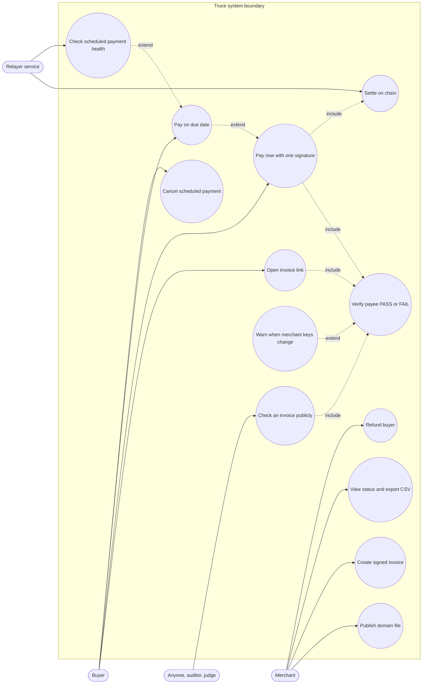

## B2. System context (C4 level 1)
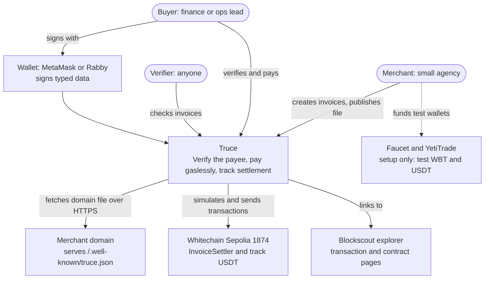

## B3. Containers and components (C4 levels 2 and 3)
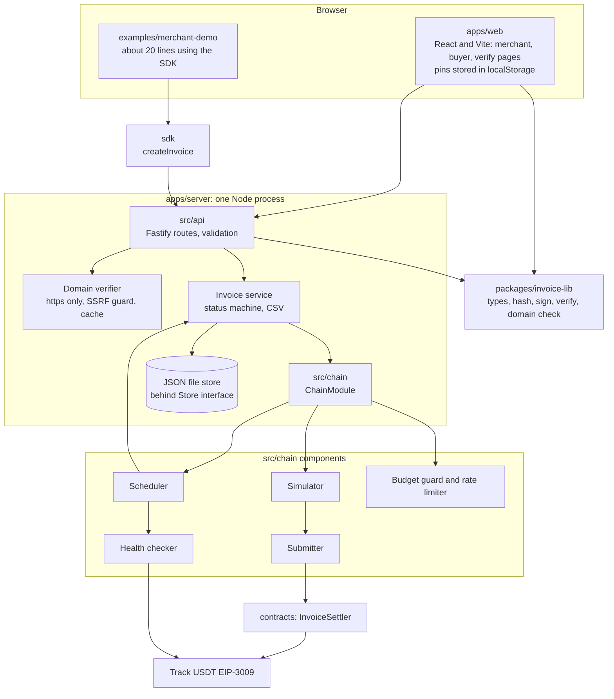

## B4. Sequence diagrams

### B4.1 Merchant setup and invoice creation
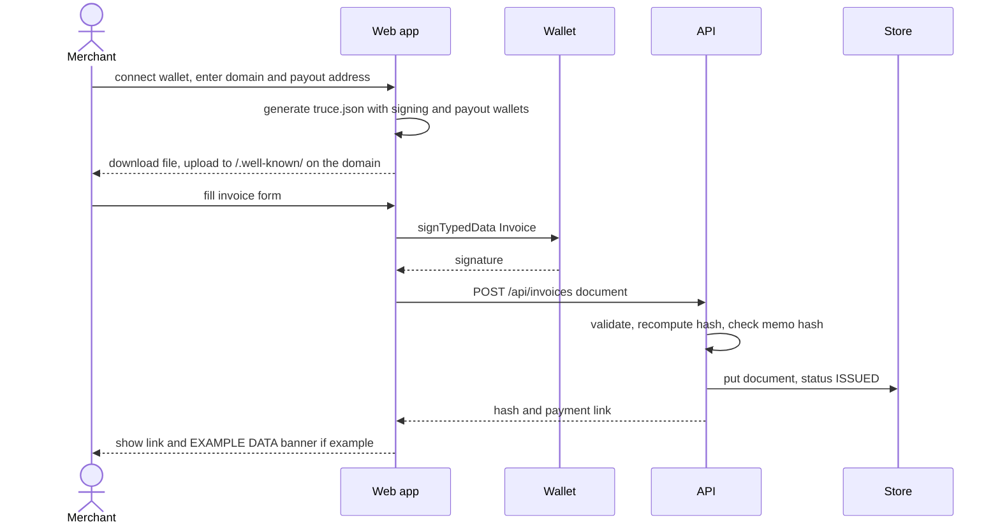

### B4.2 Buyer verifies, happy path (PASS)
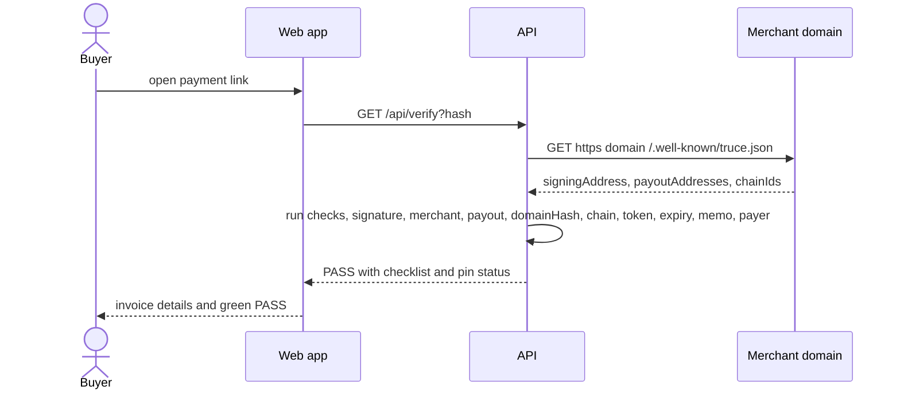

### B4.3 Attack: swapped payout (FAIL in the app, revert on chain)
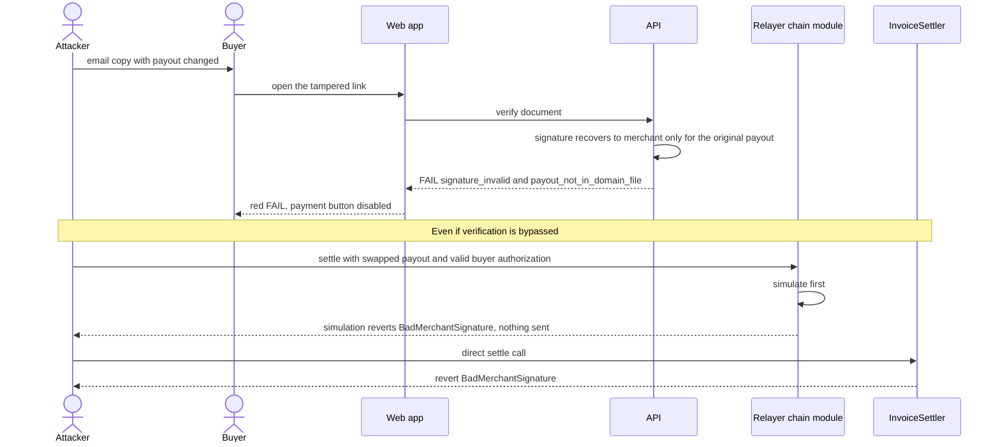

### B4.4 Pay now
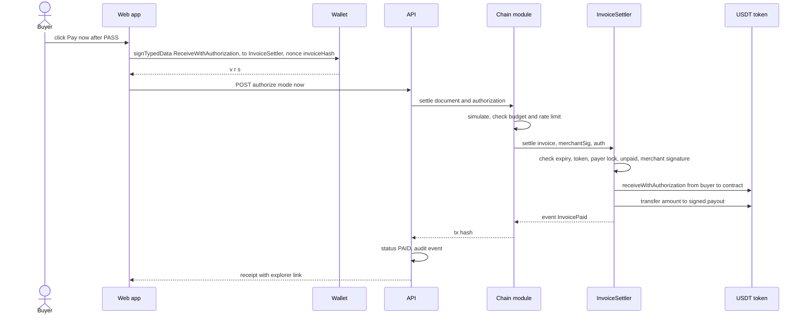

### B4.5 Pay on due date with health checks and failure path (SHOULD)
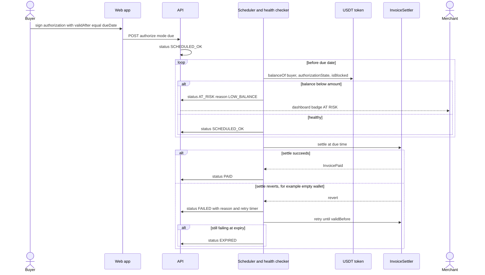

### B4.6 Buyer cancels a scheduled payment (SHOULD)
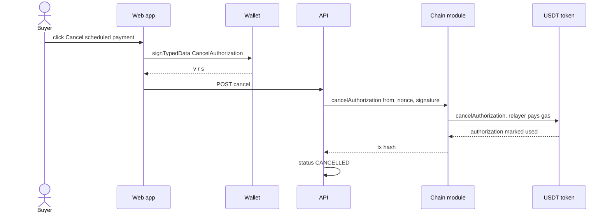

### B4.7 Refund (SHOULD, contract and tests only)
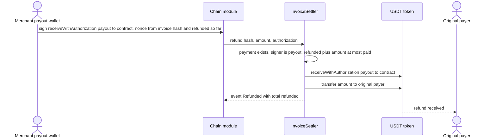

## B5. Data model (ER)
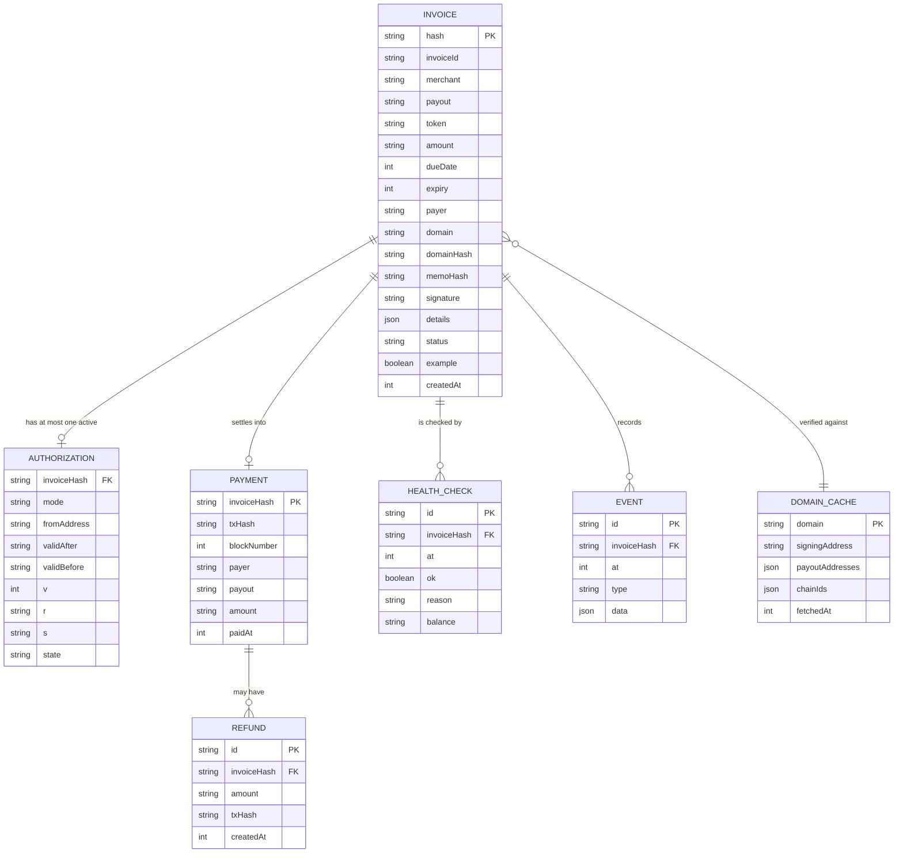
Browser-only data (not in the ER): key pins in `localStorage`, keyed by domain.

## B6. State machine: invoice status
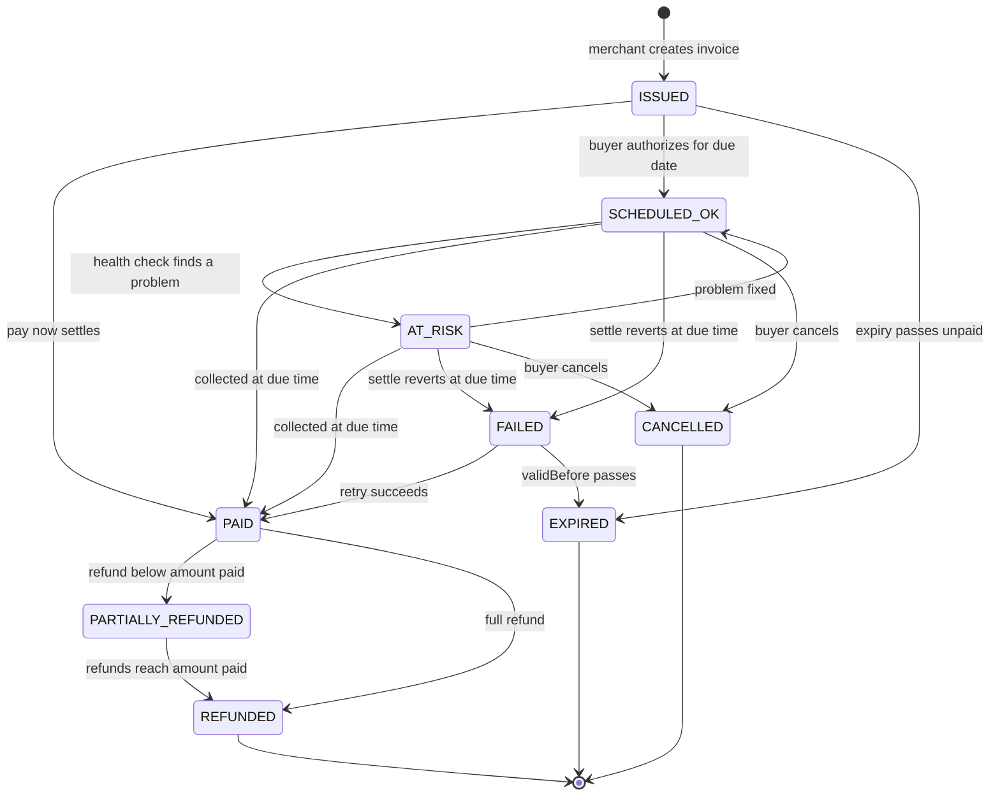

## B7. Deployment diagram
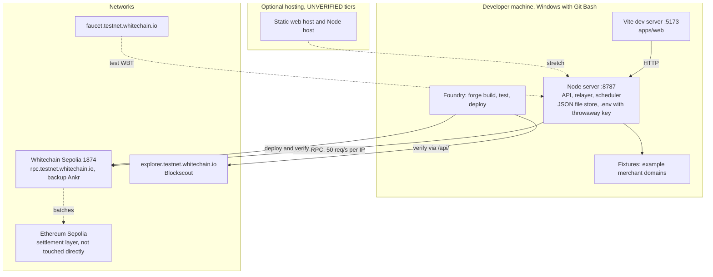
Environments: **local mock** (`CHAIN_MODE=mock`, no network), **testnet** (`CHAIN_MODE=testnet`, real chain 1874), **demo** (testnet with example fixtures and the EXAMPLE DATA banner). No mainnet.

## B8. Trust boundaries and threat model
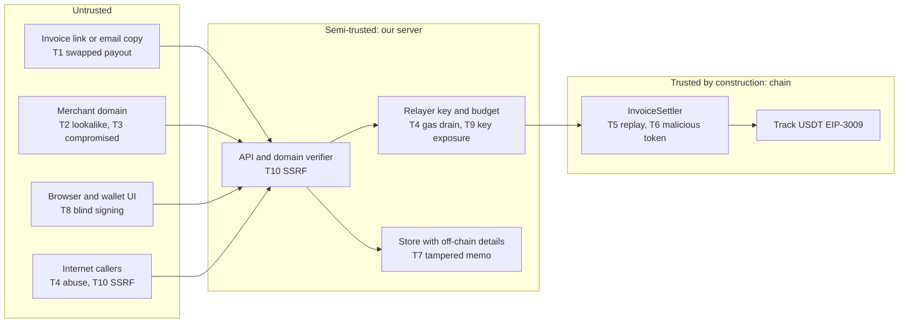
The mitigations for T1 to T10 are in `C-TECHNICAL.md` section 7.
