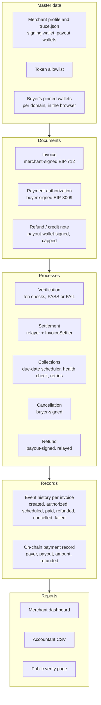

# G. ERP-style view of Truce (a way to read the architecture, not an ERP)

Truce is organised the way an accounts-receivable module is, with documents, processes, a record of what happened and reports. This page maps the parts so a reader who knows ERP systems can find their way. It is **not** an ERP, it does not connect to one, and it has no users, roles or approval workflows.

## The layers

## The mapping

| ERP idea | In Truce | Where in the code |
|---|---|---|
| Master data | Merchant setup and the published `truce.json`; the token allowlist; the buyer's pinned wallets | `apps/web` (`/setup`, `lib/pins.ts`), `contracts/` (`tokenAllowed`) |
| Sales document with a lifecycle | The invoice moves through `ISSUED`, `SCHEDULED_OK`, `AT_RISK`, `PAID`, `FAILED`, `CANCELLED`, `EXPIRED` | `apps/server/src/api/status.ts` |
| Payment instruction | The buyer's signed authorization (pay now, or valid from the due date) | `packages/invoice-lib/src/authorization.ts` |
| Payment clearing | Settlement through `InvoiceSettler`, which pays only the signed payout and settles each invoice once | `contracts/src/InvoiceSettler.sol` |
| Credit note | The refund: signed by the payout wallet, sent to the original payer only, never above the amount paid | `refund` in the contract; `POST /api/invoices/:hash/refund` |
| Collections | A scheduler collects on the due date with retries and backoff; a health check warns before the due date | `apps/server/src/scheduler.ts` |
| Audit trail | The event history per invoice, with timestamps and transaction links | `InvoiceRecord.events` in the store |
| Internal control | The merchant's signature acts as the approval; the contract enforces it at the moment money moves | `settle` in the contract |
| Reporting | Dashboard totals, the accountant CSV (with refunds), the public verify page | `apps/web`, `api/csv.ts` |
| Journal | A ledger export with one row per money movement: invoice issued (debit receivable, credit revenue), payment (debit cash, credit receivable), refund (debit sales returns, credit cash), each payment and refund with its transaction | `apps/server/src/api/ledger.ts`, `GET /api/merchants/:address/ledger.csv` |

## Three-way match

ERP systems reconcile a purchase order, a goods receipt and an invoice. Truce lines up three records instead:

1. **The merchant's signed invoice** (what was billed, and to which payout wallet).
2. **The buyer's signed authorization** (what the buyer agreed to pay, and when).
3. **The on-chain payment record** (what actually moved), which plays the role of the bank statement.

The third record is public, so anyone can recompute the invoice hash and compare it with the chain. The public verify page does exactly that.

## What this view does not claim

- It is not an ERP, and there is no ERP integration. The exports are files for an accountant. The ledger uses four illustrative account names, not a chart of accounts for any country.
- Only money movements are in the ledger. A cancelled authorization, a failed collection or an expiry moves no money and stays in the event history.
- Refunds in the exports are the ones this server recorded; the chain is the source of truth.
- There are no user accounts, roles, approvals or segregation of duties. One merchant wallet signs; there is no merchant login.
- The event history is stored in a JSON file on our server. The on-chain record is the only part that does not depend on us.
- Tax, accounts payable, inventory and period closing are not covered.
